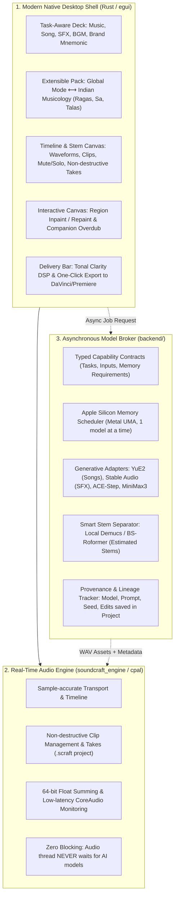

# Open-Source AI DAW: Research Synthesis & Strategic Architecture

## 1. Executive Synthesis: The Research Brief & Your Vision

The research brief you provided is an extraordinary document. It provides the exact theoretical and engineering framework that bridges what you felt was missing from SoundCraft and what you need for your actual workflow.

### The Two Major Breakthroughs from the Brief

1. **"The product is not an 'Indian music DAW'" — It is a General-Purpose Creative Audio Workstation with an Extensible Indian Musicology Pack:**
   - The brief states (Section 1):  
     > *"The DAW should be a general-purpose creative audio workstation with AI-assisted creation and production, designed for users around the world. Indian musical traditions are a meaningful source of features, workflows, presets, data partnerships, and domain knowledge—first-class, but as an extensible pack."*
   - This directly solves the problem you raised: existing generative models fail completely on Indian music (Classical, Carnatic, Pop, Rock, Metal, Vedic chanting) because they lack domain priors. By building Indian music principles as a **first-class specialized pack** (with RagaBridge, 22 Shrutis, Moveable $Sa$, Talas, and Gamaka pitch lanes) on top of a **global audio workstation**, the tool can generate authentic Indian music *without* boxing you into an exotic caricature or limiting your ability to produce brand films, documentary cues, or sound design.

2. **The False Dichotomy: Cluttered Pro Tools Clone vs. Flimsy Web Prompt Box:**
   - **Why the WebUI (`app/`) alone is insufficient for your workflow**:  
     The brief emphasizes (Section 1.8 & 5.1):  
     > *"Professional audio foundations: transport, timeline, non-destructive editing, stable playback, automation, routing, monitoring, export, and project portability are core—not later AI add-ons. Do not run Python inference inside the real-time audio callback."*  
     A browser-based Web Audio app cannot provide sample-accurate playback, reliable multi-stem timeline editing, or robust local process and memory management on Apple Silicon.
   - **Why the raw SoundCraft pivot felt wrong**:  
     SoundCraft was an uncurated clone of **Avid Pro Tools 1995**, cluttered with vintage studio menus (Shuffle, Slip, Spot, Aux busses, VST scanners) while throwing away the generative intelligence and faking the stem separation.
   - **The True Answer (The Sweet Spot)**:  
     Use **Rust's rock-solid, sample-accurate audio engine** (`soundcraft_engine`, `soundcraft_playback`, CoreAudio) as the foundation, but **completely replace the vintage Pro Tools UI with the clean, task-aware Creative AI Studio** specified in the research brief.

---

## 2. Core Architecture: Mapping Research to Code



---

## 3. Detailed Component Specifications

### A. Task-Aware Generation (Section 1, 4.3, 8)
Do not put all models in one generic dropdown. The UI presents clear **production task modes**:

| Task Mode | Primary Use Cases | Engine / Adapter | Cultural / Specialized Pack Options |
| :--- | :--- | :--- | :--- |
| **Music Track & Song** | Artist production, indie releases, Indian Pop/Rock/Metal. | YuE 2 / MiniMax 3 / ACE-Step 1.5 | General / Western, Indian Classical, Indian Rock/Metal, Sufi. |
| **Film & Documentary Score** | Cues, underscore, emotional arcs, scene reference beds. | Stable Audio 3 / MiniMax 3 | Raga mood anchors, cinematic drones, acoustic world textures. |
| **Brand Film & Sonic Branding** | Sonic logos, mnemonics, cutdowns (2s, 5s, 15s, 30s). | Stable Audio Open / AudioCraft | Motif preservation bank, delivery specs. |
| **Sound Design & Foley** | Transitions, risers, drops, whooshes, braams, textures. | Stable Audio Open / MMAudio | Tuned to tonic $Sa$, somatic 10–20Hz infrasound impact. |
| **Vocal & Sacred Recitation** | Sanskrit mantras, Vedic recitation, wordless aalap. | ACE-Step / Vagdhenu Phonetics | Vāgdhenu zero-schwa deletion, Udātta/Anudātta accents. |

### B. The Extensible Indian Musicology Pack (Section 7)
When the Indian Music pack is enabled:
- **Moveable Sa ($f_{Sa}$)**: Tuned continuous root (e.g. 136.1 Hz Om, C#, D).
- **RagaBridge Conditioning**: Dual-conditions prompts with both Raga swara grammar and Western modal anchors (e.g., *Yaman $\rightarrow$ Lydian #4*, *Bhairavi $\rightarrow$ Phrygian*) so models do not hallucinate out-of-tune Western clichés.
- **Tala & Meter**: Teental (16), Rupak (7), Keherwa (8), Jhaptal (10), Adi Tala, plus unmetered *Aalap*.
- **Ornamentation Lanes**: Pitch gesture lanes for *Meend* (glides) and *Gamakas*.
- **Authentic Timbre Priors**: Explicit physical descriptors for Bansuri, Sitar, Sarod, Veena, Tabla, Pakhawaj, Mridangam, and Tanpura.

### C. Smart Stem Separation & Inpainting (Section 4.1, 5.3, 11)
- **Separation as Post-Process**:  
  When a track is generated, the asynchronous worker runs local Demucs/BS-Roformer, automatically producing 5 discrete, aligned audio clips:
  1. `Lead Melody` (Sitar, Bansuri, Guitar, Lead Synth)
  2. `Vocals` (Lead voice, choir, or recitation)
  3. `Rhythm & Tala` (Tabla, Pakhawaj, Drums)
  4. `Harmony & Textures` (Harmonium, pads, strings)
  5. `Drone & Sub` (Tanpura, Somatic Infrasound)
  - *Provenance tag*: Labeled transparently as **"Estimated Stems"** alongside the original stereo mix take.
- **Region Inpainting ("Repaint")**:  
  Highlight a time range on a stem $\rightarrow$ provide an iterative prompt (*"add fast sitar jhala here"* or *"silence vocal"*). The worker generates a replacement clip non-destructively with crossfades.
- **Companion Overdub Track**:  
  Click **"+ Add Companion Layer"** (e.g., flute solo, voiceover, percussion fill) locked to the exact same $Sa$, Raga, and BPM, placed on a new track in the timeline.

### D. Cinema Pre-Master & DaVinci / Premiere Export (Section 4.4, 6.5, 8.1)
- **Tonal Clarity DSP**:
  - 96kHz Hypersonic Air (20kHz–48kHz) to eliminate digital diffusion harshness.
  - Somatic Infrasound (10Hz–20Hz) chest resonance.
  - Transparent limiter set to platform loudness targets (-14 LUFS streaming, -24 LUFS broadcast film).
- **One-Click Export to DaVinci Resolve & Premiere Pro**:
  - Generates an aligned delivery folder:
    ```
    Project_Cue_Bhairav/
    ├── Stems/
    │   ├── 01_Lead_Melody_24bit.wav
    │   ├── 02_Vocals_24bit.wav
    │   ├── 03_Rhythm_Tala_24bit.wav
    │   ├── 04_Harmony_Pads_24bit.wav
    │   └── 05_Drone_Tanpura_24bit.wav
    ├── Master_Cinema_Mix_24bit.wav
    ├── Project_Metadata.json (Prompt, Model, Seed, Key/Sa, BPM, Tala, Rights)
    ```
  - Directly drag-and-drop into DaVinci Fairlight or Adobe Premiere Pro multi-track timelines.

---

## 4. Implementation Phasing (Aligned with Research Brief Section 11 & 15)

### Phase 1: Reliable Audio Foundation & Clean UI Shell (Current Step)
- Strip the vintage Pro Tools DAW clutter (vintage edit ribbons, bus matrices, VST scanners) from `soundcraft/crates/ui-egui`.
- Implement the streamlined **Nād Generative Studio View**:
  - Top: Task & Brief Deck (Music, SFX, BGM, Brand).
  - Center: 5-lane Stem Canvas with non-destructive timeline clips, waveforms, and playback.
  - Bottom: Cinema Mastering & "Export to DaVinci / Premiere" button.

### Phase 2: First Generative Vertical Slice (Local Apple Silicon)
- Connect the UI asynchronously to the backend model broker (`backend/nad-backend`).
- Enforce the **Model Capability Contract**: memory checking on M1 Max, progress tracking, and non-blocking background generation.
- Implement real Demucs stem separation so the 5 lanes receive actual audio clips.

### Phase 3: Inpainting & Extensible Indian Musicology Pack
- Wire RagaBridge, Moveable $Sa$ continuous tuning, Talas, and Vocal Modes (Instrumental vs. Lyrics vs. Aalap vs. Vedic).
- Enable timeline region inpainting ("Repaint") and companion track overdubbing.

### Phase 4: Delivery Profiles & Production Workflows
- Add brand film cutdowns (5s/15s/30s), cue cards, and DaVinci/Premiere folder export.
- Full provenance recording (model revision, prompt, seed, license metadata).
