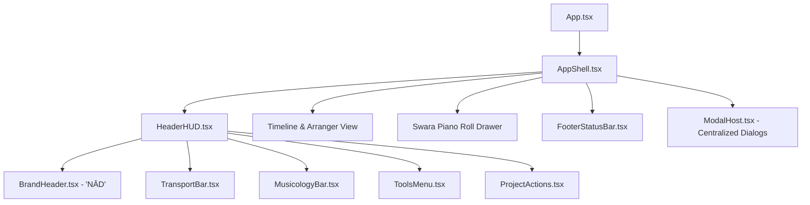

# Implementation Plan - Main Layout & Shell Redesign

## Goal Description
Refactor and declutter the **Main Layout & Shell** of the DAW (Step 1 of the incremental in-place frontend overhaul). Currently, `App.tsx` is over 1,650 lines long, `HeaderHUD.tsx` contains 782 lines with over 60 drilled props, and the interface suffers from visual and cognitive clutter. This refactor will:
1. Rebrand the application header to **"NĀD"** (with sleek typography and updated logo framing).
2. Decompose the monolithic `HeaderHUD.tsx` into clean, modular subcomponents:
   - `BrandHeader`: Logo, "NĀD" wordmark, version tag.
   - `TransportBar`: Play/pause/stop, BPM, time signature, and metronome controls.
   - `MusicologyBar`: Moveable $Sa$ tuning, Raga selector, Tala meter, and Tanpura drone.
   - `ToolsMenu`: Clean grouped launcher for Studio Engines (AI Orchestrator, StemForge, Spatial Audio, 96kHz Spectrum, Vagdhenu).
   - `ProjectActions`: Undo/Redo, Snapshots/Branch, Save project, Export master.
3. Extract the bottom status bar from `App.tsx` into a dedicated `FooterStatusBar` component.
4. Introduce a unified `ModalHost` or modal management pattern to remove 15+ boolean states and 150+ lines of modal JSX from `App.tsx`.
5. Ensure 100% backward compatibility with all existing audio, raga, and backend engine hooks.



---

## User Review Required

> [!IMPORTANT]
> **Branding Change:**
> The header logo and title will officially change from "NADABRAHMA" to **"NĀD"** (subtitled *"Universal Audio Workstation"* or *"AI Sound & Music"*).
> 
> **Refactor Strategy:**
> This refactor will be executed in-place within the existing `app/src/` directory. No existing audio logic (`webAudioEngine`, `ragaEngine`, `timeEngine`) or Go backend endpoints will be broken or removed.

---

## Open Questions

None at this stage — the scope was confirmed during the `/grill-me` session to focus on the Main Layout & Shell first, working iteratively in-place.

---

## Proposed Changes

### Component: Shell & Layout Structure (`app/src/components/layout/`)

We will create a clean `layout/` directory inside `app/src/components/` to organize shell components by responsibility.

---

#### [NEW] `app/src/components/layout/BrandHeader.tsx`
- Displays the updated logo and the clean **"NĀD"** wordmark.
- Replaces the bulky text and logo wrapper with a modern, glassmorphic brand badge.

```tsx
import React from 'react';

interface BrandHeaderProps {
  onOpenModelLibrary?: () => void;
}

export const BrandHeader: React.FC<BrandHeaderProps> = ({ onOpenModelLibrary }) => {
  return (
    <div className="flex items-center gap-2.5 shrink-0">
      <div 
        onClick={onOpenModelLibrary}
        className="w-8 h-8 rounded-lg overflow-hidden border border-amber-500/30 flex items-center justify-center bg-black/80 shadow-[0_0_12px_rgba(245,158,11,0.2)] cursor-pointer hover:border-amber-400 transition"
        title="NĀD Sound & Music Workstation - Click to open Model Library"
      >
        
      </div>
      <div className="flex flex-col">
        <div className="flex items-center gap-1.5 leading-none">
          <span className="font-black tracking-widest text-sm text-slate-100 font-sans">
            NĀD
          </span>
          <span className="text-[9px] px-1 py-0.2 rounded bg-amber-500/20 text-amber-300 font-mono font-semibold border border-amber-500/30">
            PRO
          </span>
        </div>
        <span className="text-[9px] text-slate-400 font-mono tracking-tight uppercase opacity-75 mt-0.5">
          AI Audio Workstation
        </span>
      </div>
    </div>
  );
};
```

---

#### [NEW] `app/src/components/layout/TransportBar.tsx`
- Encapsulates playback controls (`Play`, `Pause`, `Stop`), BPM tempo input, Time Signature selector, and the Metronome toggle + popover.
- Eliminates 180 lines of nested transport code from the main header.

---

#### [NEW] `app/src/components/layout/MusicologyBar.tsx`
- Houses the Indian Classical musicology parameters:
  - Moveable $Sa$ frequency readout & pitch detection popup.
  - Active Raga dropdown selector (filtered by Navarasa).
  - Active Tala rhythmic clock & Matra meter.
  - Real-time Tanpura drone toggle.

---

#### [NEW] `app/src/components/layout/ToolsMenu.tsx`
- Consolidates the various disparate engine buttons into an organized, elegant studio tools menu:
  - **Generative AI:** Director's Wizard, AI Model Orchestrator, Model Library, Renders Gallery.
  - **Acoustic & DSP:** 22 Shrutis Mandala, StemForge (Stem Separation), Spatial Audio 3D, 96kHz Extended Spectrum, Vāgdhenu Vedic Chants, VST/Audio Plugins.

---

#### [NEW] `app/src/components/layout/ProjectActions.tsx`
- Houses Project Save (`.nad`), Master Export, Undo/Redo with history action tooltips, and Session Snapshot/Branching tree trigger.

---

#### [NEW] `app/src/components/layout/FooterStatusBar.tsx`
- Extracts lines 1403-1488 of `App.tsx` into a reusable, self-contained status bar.
- Displays:
  - Left: Active Raga / Western Mode bridge, Vadi/Samvadi, Git Branch, MIDI device count, Active Audio Plugins, Movement section.
  - Center: Live notification toast messages.
  - Right: Apple Silicon M1 Max 32GB Memory budgeter & 96kHz / 32-bit CoreAudio status pill.

---

#### [NEW] `app/src/components/layout/ModalHost.tsx`
- Extracts the 14 inline modal declarations at the bottom of `App.tsx` into a dedicated host component.
- Keeps `App.tsx` clean and under 300 lines.

---

#### [MODIFY] `app/src/components/HeaderHUD.tsx`
- Rebuilt as a clean orchestration container that composes `BrandHeader`, `TransportBar`, `MusicologyBar`, `ToolsMenu`, and `ProjectActions`.
- Reduces `HeaderHUD.tsx` from 782 lines of cluttered JSX down to ~120 lines of clean component assembly.

---

#### [MODIFY] `app/src/App.tsx`
- Replaces inline header and footer code with the newly modularized components.
- Delegates modal rendering to `ModalHost`.
- Maintains all existing state, undo/redo history, audio playback, and timeline synchronization.

---

## Verification Plan

### Automated Tests
Run TypeScript type-check and Vite build to guarantee zero broken imports or missing props:
```bash
cd app && npm run build
```

### Manual Verification
1. **Visual Inspection:**
   - Verify header shows **NĀD** with the brand logo and badge.
   - Verify layout is clean, responsive, and does not overlap on standard screens.
2. **Transport Verification:**
   - Test Play, Pause, Stop buttons.
   - Change BPM and Time Signature (e.g. 4/4 to 7/8).
   - Toggle Metronome and adjust its volume/timbre.
3. **Musicology Engine:**
   - Change Raga (e.g., Yaman to Bhairav).
   - Change Tala (Teental, Rupak, Jhaptal).
   - Toggle Tanpura drone and adjust Moveable $Sa$.
4. **Tools & Modals:**
   - Open Director's Wizard, AI Orchestrator, Shruti Mandala, StemForge, and Master Mixer from the Tools menu.
   - Verify all modals open and close cleanly.
5. **Backend & Status:**
   - Verify M1 Max memory readout and 96kHz status pills in the FooterStatusBar remain responsive.
