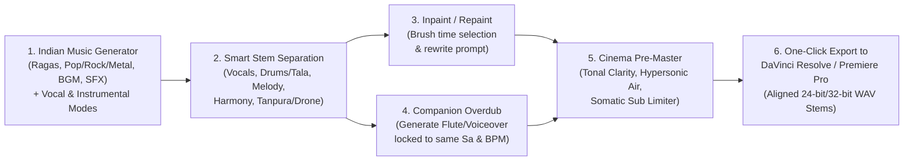

# Nād Generative Studio: Architecture & Product Blueprint

## 1. Executive Summary & The Core Revelation

Your insight completely crystallizes the true purpose of Nādabrahma:
> *"I'm not sure about what soundcraft has to offer me since anyways I'm going to redesign the sound in DaVinci Resolve or Adobe Premiere Pro. What my purpose is: most generative models fail to generate Indian music (Indian classical, Indian pop, rock, metal, Carnatic, etc.) and this is where my purpose lies — to generate tracks (background music, music with lyrics or instrumental, sound effects) and mixing/mastering before taking it to the video post-production tool. The idea is a simple interface which can generate the track, get smartly separated stems, and then either repaint particular sections or generate a companion track along the similar genre so that it blends seamlessly and cinema-mix it further."*

### Why SoundCraft's Pro Tools Paradigm was Mismatched
SoundCraft is an open-source Rust clone of **Avid Pro Tools**. It is designed for multi-mic studio recording, vintage mixing consoles, VST3 plugin racks, and audio automation. **You already have DaVinci Resolve (Fairlight) and Adobe Premiere Pro for video sync, dialogue leveling, and final post-production.** Duplicating a 1990s Pro Tools interface was unnecessary baggage that obscured what you actually need.

### The Real Problem: Why AI Fails at Indian Music
Existing AI music models (Suno, Udio, Stable Audio, MusicLM) fail dramatically on Indian music because:
1. **12-TET Bias**: They quantize pitches to Western equal temperament, erasing the 22 Shrutis, microtonal inflection (*meend*), and micro-oscillations (*andolan*).
2. **Harmonic Clichés**: When prompted for Indian instruments, they force Western functional harmony (I-IV-V chord progressions) instead of modal development over a drone.
3. **Instrument & Vocal Confusion**: Off-the-shelf models confuse a Sitar with an acoustic guitar, a Bansuri with a Western silver flute, and hallucinate synthetic English singing when a pure instrumental or wordless *aalap* is requested.
4. **Lack of Genre Diversity**: They cannot handle contemporary Indian styles—such as Indian Rock (ragas over heavy distortion), Indian Metal, Carnatic Fusion, Sufi Pop, or Sacred Vedic Chants—without devolving into tourist clichés.

---

## 2. The Nād Generative Studio Workflow



---

## 3. Detailed Studio Capabilities

### A. The 6 Generation Domains
Rather than generic prompt boxes, Nād offers 6 dedicated Indian music production modes:

| Mode | Target Audio Output | AI Conditioning & Prompt Priors |
| :--- | :--- | :--- |
| **Indian Classical** | Pure Hindustani & Carnatic recitals (Dhrupad, Khayal, Kriti). | RagaBridge thaat/mode mapping, 22 Shrutis intonation, strict moveable $Sa$ drone, Tala rhythm cycles. |
| **Indian Pop & Bollywood** | Catchy Indian melodies, modern electronic beats, sitar/flute hooks. | Melodic swara hooks with contemporary production, acoustic rhythm blends (Dholak + 808s). |
| **Indian Rock & Metal** | Heavy distorted guitars playing raga scales, dual tabla/double-kick drums. | Sitar-guitar unisons, Raag Bhairav / Todi metal riffs, soaring pentatonic Carnatic guitar solos. |
| **Cinematic BGM & Soundscapes** | Atmospheric tension, emotional film scores, temple ambiances. | Dynamic builds, modal chords, spatial reverberation, subtle tanpura undertones. |
| **Vedic & Devotional / Sufi** | Sanskrit Vedic mantras, Stotras, Sufi Qawwali claps & harmonium. | Vāgdhenu zero-schwa deletion, Udātta/Anudātta pitch accents, hypnotic devotional repetition. |
| **SFX, Foley & Transitions** | Risers, Sub Drops, Braams, Whooshes, temple bells, conch shells. | Transitions tuned to tonic $Sa$, pre-drop silence cuts, somatic 10–20Hz low-frequency impact. |

### B. Vocal & Arrangement Control
* **Pure Instrumental**: Strict negative prompt conditioning (`"no vocals, no singing, no choir, no human voice"`) to guarantee zero rogue vocal hallucinations.
* **Music with Lyrics**: Custom lyrics input with Sanskrit/Hindi meter parsing and phonetic formatting.
* **Wordless Aalap & Taans**: Sargam vocalises without lyrics (*Aa, Re, Na, Dheem*).
* **Voiceover / Spoken Word**: Clean dialogue or sacred recitation over an unmetered ambient bed.

### C. Smart Stem Separation (The 5 Core Lanes)
Upon generation, the track is separated into 5 discrete, phase-aligned stems:
1. **Melody / Lead**: Sitar, Bansuri, Sarod, Lead Guitar, Violin, Shehnai.
2. **Vocals / Chants**: Lead vocals, backing choir, Vedic chants, or voiceover.
3. **Rhythm & Tala**: Tabla (Bayan/Dayan), Pakhawaj, Mridangam, Dholak, Drums.
4. **Harmony & Texture**: Acoustic chords, ambient pads, harmonium, strings.
5. **Drone & Sub**: Miraj Tanpura overtone cascade + Somatic Infrasound (10–20Hz).

### D. Inpaint / Repaint & Seamless Companion Overdubbing
1. **Time-Range Repaint (Inpainting)**:
   - Scrub and select a 5-second region on any stem (e.g., the Lead Sitar stem at 00:15–00:20).
   - Enter a localized prompt: *"Change from slow meend to fast jhala taan"* or *"Remove vocal fill here"*.
   - The engine regenerates only that time window with smooth crossfades at the boundaries.
2. **Companion Overdub Track (Layering)**:
   - Click **"+ Add Companion Layer"** on an existing project.
   - Choose a target: *"Solo Bansuri Improvisation"* or *"Narrator Voiceover"*.
   - The engine automatically locks to the project's **Root $Sa$**, **Raga/Scale**, **BPM**, and **Tala**, generating a new aligned stem that blends seamlessly with the existing tracks.

### E. Cinema Pre-Master & Export for DaVinci / Premiere
* **Tonal Clarity DSP**:
  - **Hypersonic Air (20kHz–48kHz)**: Adds organic acoustic shimmer and eliminates harsh digital diffusion artifacts.
  - **Somatic Infrasound (10Hz–20Hz)**: Calibrated low-frequency chest resonance tuned to the root $Sa$.
  - **Master Limiter**: Transparent cinema loudness leveling (-14 LUFS for streaming, -24 LUFS for broadcast).
* **One-Click Export**:
  - Exports a dedicated folder:
    ```
    My_Score_Bhairav/
    ├── Stems/
    │   ├── 01_Lead_Melody_96k.wav
    │   ├── 02_Vocals_96k.wav
    │   ├── 03_Rhythm_Tala_96k.wav
    │   ├── 04_Harmony_Pads_96k.wav
    │   └── 05_Drone_Tanpura_96k.wav
    ├── Master_Cinema_Mix_96k.wav
    └── Project_Info.json (Key, Raga, BPM, Tala, Timecode)
    ```
  - Drag-and-drop the entire folder straight into the DaVinci Resolve Fairlight timeline or Adobe Premiere Pro multi-track sequence.

---

## 4. UI Comparison: What the Interface Looks Like

### The Cluttered SoundCraft DAW (What to Leave Behind)
- 40+ vintage menus (Edit, Mix, Shuffle, Slip, Spot, Grid, Trimmers, Scissors, Pencil).
- Complex bus routing grids, aux sends, hardware inserts, VST3 plugin scanners.
- Overwhelmed interface that distracts from generation and music creation.

### The New Nād Studio Interface (What We Build)
```
┌────────────────────────────────────────────────────────────────────────────────────────┐
│  NĀD STUDIO   │  Raag Bhairav  │  Sa: 136.1 Hz  │  Teental (72 BPM)  │ [Export to DaVinci] │
├────────────────────────────────────────────────────────────────────────────────────────┤
│  [GENERATE NEW TRACK]                                                                  │
│  Mode: [Indian Classical ▾]   Vocal: [Pure Instrumental ▾]   Engine: [YuE 2 ▾]          │
│  Prompt: "Contemplative dawn prayer over mountain peaks, solo bamboo flute glide..."   │
│  [✨ Generate & Split Stems] ━━━━━●━━━━━━━━━ 78% [Allocating Metal UMA weights...]       │
├────────────────────────────────────────────────────────────────────────────────────────┤
│  STEM CANVAS (Smart 5-Track Stems)                                                     │
│                                                                                        │
│  [M][S]  1. Lead Melody   ───[ ∿∿∿∿∿∿∿∿∿∿∿∿∿∿∿∿∿∿∿∿∿∿∿∿∿∿∿∿∿∿∿∿∿∿∿∿∿ ]────── [Repaint]  │
│  [M][S]  2. Vocals        ───[             (Instrumental Mode - Muted)       ]──────       │
│  [M][S]  3. Rhythm / Tala ───[ ∿∿∿∿∿∿∿∿∿∿∿∿∿∿∿∿∿∿∿∿∿∿∿∿∿∿∿∿∿∿∿∿∿∿∿∿∿ ]────── [Repaint]  │
│  [M][S]  4. Harmony       ───[ ∿∿∿∿∿∿∿∿∿∿∿∿∿∿∿∿∿∿∿∿∿∿∿∿∿∿∿∿∿∿∿∿∿∿∿∿∿ ]────── [Repaint]  │
│  [M][S]  5. Drone / Sub   ───[ ∿∿∿∿∿∿∿∿∿∿∿∿∿∿∿∿∿∿∿∿∿∿∿∿∿∿∿∿∿∿∿∿∿∿∿∿∿ ]────── [Repaint]  │
│                                                                                        │
│  [+ Add Companion Track] (Solo Bansuri / Voiceover / Percussion Fill)                 │
├────────────────────────────────────────────────────────────────────────────────────────┤
│  CINEMA MIX & MASTER                                                                   │
│  [✓] 96kHz Hypersonic Air   [✓] Somatic Infrasound (136.1Hz)   Loudness: -14 LUFS      │
│  [ 📁 Open Stems in Finder ]   [ 🎬 Send to DaVinci Resolve / Premiere ]               │
└────────────────────────────────────────────────────────────────────────────────────────┘
```

---

## 5. Technology Architecture: How to Implement

### Implementation Paths:
1. **Native Rust Nād Studio (Recommended if you want Rust performance)**:
   - We strip out the SoundCraft Pro Tools clutter and replace the main `egui` viewport with this sleek **Nād Studio** canvas.
   - It runs as a lightning-fast, native macOS binary with instant startup and zero lag.
   - Under the hood, it drives `backend/nad-backend` (Go/Python) for local inference, stem separation (Demucs), and inpainting.
2. **Tauri Nād Studio (Rust backend + Sleek UI)**:
   - A single native macOS `.app` powered by Rust on the backend (handling audio files, Metal GPU inference, stem splitting, and export) with a high-definition, responsive UI that reuses the existing 22 Shrutis and RagaBridge components from `app/`.
   - Offers fluid waveform scrubbing, brush-to-repaint selection, and responsive layouts.

---

## 6. Actionable Implementation Milestones

1. **Milestone 1: Backend Intelligence & Stem Pipeline**
   - Wire RagaBridge prompt expansion into all 6 production modes (Classical, Pop, Rock, Metal, BGM, SFX).
   - Hook up local stem separation (Demucs / BS-Roformer) so every generated track is automatically split into real audio files for the 5 stem lanes.
2. **Milestone 2: Focused Studio Interface**
   - Build the clean Nād Studio layout: Generator header, 5-lane Stem Canvas, Inpaint/Repaint brush, and Companion Track overdub.
   - Eliminate all Pro Tools DAW clutter (vintage menus, aux busses, VST racks).
3. **Milestone 3: Inpaint & Companion Generation Engine**
   - Implement the time-selection repainting trigger.
   - Implement companion overdub generation locked to the current project's $Sa$, Raga, and BPM.
4. **Milestone 4: Cinema Mastering & DaVinci/Premiere Export**
   - Implement 96kHz Hypersonic Air & Somatic Sub DSP.
   - Implement one-click export generating aligned multi-track stems and project manifest for DaVinci Resolve Fairlight and Adobe Premiere Pro.
