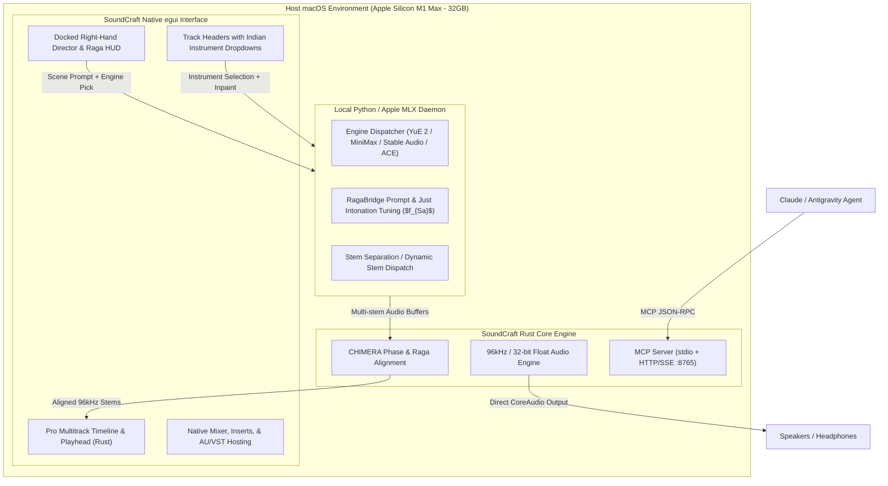

# Nādabrahma + SoundCraft Architectural Alignment Plan

## 1. Executive Summary & Validated Decisions

Following our `/grill-me` architectural review, we have converged on a unified, high-performance architecture that eliminates dummy UI clutter, solves the Western model training bias, and leverages **SoundCraft** (`storytold/soundcraft`) as our rock-solid native DAW engine on Apple Silicon M1 Max.

### Key Decisions Locked In:
1. **Single Native Engine**: Clone `soundcraft` directly into `nadabrahma`. No dual DAW servers. SoundCraft's Rust + `egui` architecture replaces the previous web timeline, giving zero-jitter playhead tracking, sample-accurate bar division, native plugin hosting, and 120fps UI performance.
2. **Visual Theme**: Harmonize SoundCraft's styling with Nādabrahma's dark aesthetic (Obsidian base, deep saffron accents `#FF9933`, gold `#D4AF37`, and cyan/teal shruti highlights).
3. **Empty Project Initial State**: Projects start clean with 0 tracks. The workflow begins at the Director prompt rather than 8 arbitrary placeholder tracks.
4. **Dockable Right-Hand Inspector Sidebar**: "Director Scene Scoring & Raga HUD" lives in a collapsible panel on the right side of the SoundCraft timeline, accessible anytime without covering the tracks.
5. **AI Generation Engine Selector**: Users can choose their target engine per generation (**YuE 2, Stable Audio 3, MiniMax 3, ACE Studio**) routed through a local Python/MLX IPC daemon.
6. **Smart Dynamic Stems to Discrete Tracks**: The generated scene automatically unpacks into discrete tracks (e.g. Lead, Rhythm, Drone, Vocal, Texture).
7. **Per-Track Indian Instrument Control (Overcoming Model Bias)**:
   - Each track header features an **Indian Instrument Dropdown** (Bansuri, Sitar, Sarod, Tabla, Pakhawaj, Tanpura, Vedic Recitation, etc.).
   - Conditioning is isolated to the specific instrument's acoustic priors (*meend, gamaka, bol* phrasing), overcoming Western AI bias.
   - Dual actions: **Quick Regenerate** on track header (whole stem) + **Timeline Range Inpainting** for surgical edits.
   - **CHIMERA** aligns tempo, shifts pitch to continuous $f_{Sa}$, and phase-matches regenerated audio.
8. **Dual MCP Server for Claude / Antigravity**:
   - `stdio` transport for headless scripting/video scoring.
   - Local `HTTP/SSE` server for live DAW control while the GUI is running.

---

## 2. System Architecture Diagram

---

## 3. Work Breakdown & Phased Implementation

### Phase 1: Repository Ingestion & Rust Toolchain Setup
- Clone `storytold/soundcraft` into the workspace (`soundcraft/`).
- Inspect Cargo crates, dependencies, and build requirements.
- Verify full native build on Mac M1 Max (`cargo check`, `cargo build --release`).
- Set up theme token file mapping SoundCraft's egui colors to Nādabrahma's visual palette.

### Phase 2: Dockable Right-Hand "Director & Raga HUD" Panel
- Build the `egui` dockable sidebar component:
  - **Director Scene Scoring**: Scene description, Rasa emotion selector (Navarasa), Aalap toggle, Moveable Sa slider ($f_{Sa}$ in Hz, 100-300 Hz), Tala clock.
  - **Model Selector**: Dropdown to select generation engine (YuE 2, Stable Audio 3, MiniMax 3, ACE).
  - **Generate Button**: Dispatches async job to the daemon with progress indicator.

### Phase 3: Track Header Indian Instrument Dropdown & Regeneration Actions
- Extend SoundCraft's `TrackHeader` struct with:
  - Instrument Category & Preset Selector (Plucked, Bowed, Wind, Percussion, Vedic Vocal).
  - Quick Regenerate button ✨ (re-scores stem using current audio as acoustic prior).
- Implement timeline range selection trigger for **Inpaint Mode**.
- Integrate CHIMERA alignment callback when a stem is updated.

### Phase 4: Local Python/MLX Daemon & Smart Stem Pipeline
- Create a lightweight, robust daemon (`scripts/daemon.py` or `engine/daemon.py`) communicating over JSON-RPC / Unix domain socket or localhost HTTP.
- Implement RagaBridge prompt expansion:
  - When user selects an Indian instrument, inject authentic playing techniques (*dha/dhin* thekas, *meend*, *andolan*, *shruti* microtonal tuning) to counteract Western model bias.
- Handle Smart Dynamic Stems or Demucs fallback to unpack audio files into SoundCraft track slots.

### Phase 5: Dual MCP Server Integration (Claude / Antigravity)
- Build the MCP interface:
  - Standard I/O handler (`soundcraft --mcp`) for CLI/Agent control.
  - Embedded HTTP/SSE listener (`http://127.0.0.1:8765/mcp`) running alongside the GUI.
- Expose core tools:
  - `score_scene(prompt, rasa, raga, sa_hz, engine)`
  - `add_stem_track(instrument, audio_path)`
  - `regenerate_track(track_id, instrument, inpaint_range)`
  - `set_raga_tuning(raga_name, sa_hz)`
  - `render_master(export_path, super_res_96k)`

---

## 4. Verification & Testing Strategy

1. **Compilation Test**: SoundCraft builds cleanly with Cargo on M1 Max without errors.
2. **UI & Theme Test**: SoundCraft opens with Nādabrahma dark theme, empty project timeline, and docked Director sidebar.
3. **Timeline Ergonomics**: Verify playhead precision, zoom, and uniform bar division.
4. **Director Generation Flow**: Fill scene prompt → select engine → generate → verify discrete stems load automatically onto separate tracks.
5. **Per-Track Indian Instrument Workflow**: Select Track 2 (Rhythm) → switch dropdown to "Tabla (Teental)" → hit Regenerate → verify prompt conditioning and CHIMERA alignment.
6. **MCP Protocol Verification**: Execute a test MCP request from terminal/agent to trigger a scene score and verify track population in real time.
