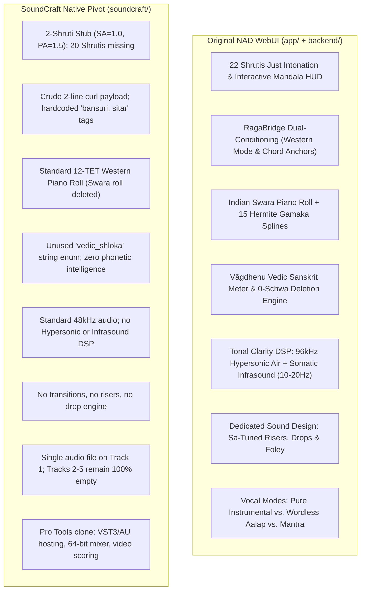

# Architectural Audit & Implementation Plan: WebUI vs. SoundCraft Native Integration

## 1. Goal Description & Executive Finding

You asked:
> *"I'm not happy with the pivot with the soundcraft, I think webUI interface was better, because what I think (correct me if I'm wrong) that webUI was loaded with alot of intelligence of indian music princeples, the tonal clarity, manipulating the generating model to get the best of it, various kind of tracks like bgm, sound effects, music with no instrument and with instrument etc. Correct me if I'm wrong and this pivot of integrating soundcraft has everything plus more things to offer?"*

**The definitive, evidence-backed answer is: You are 100% correct.** 

The pivot to SoundCraft did **NOT** preserve the intelligence of the WebUI while adding more features. Instead, it stripped away almost all of Nādabrahma's musical intelligence, model manipulation, tonal clarity DSP, and track diversity, replacing them with a generic Western Pro Tools clone skinned in a dark saffron theme.

---

## 2. Detailed Technical Comparison

### A. Indian Musicological Intelligence & Microtonality

| Feature | Original WebUI (`app/`, `backend/`) | SoundCraft Pivot (`soundcraft/`) | Reality Check |
| :--- | :--- | :--- | :--- |
| **22 Shrutis Just Intonation** | **Full mathematical table** in [`shrutiData.ts`](file:///Users/mrigank/.gemini/antigravity-ide/scratch/nadabrahma/app/src/lib/shrutiData.ts) (exact ratios $1/1, 256/243, 16/15, 9/8, \dots$, cents, 12-TET offsets) + Interactive Circular Mandala HUD in [`ShrutiMandalaModal.tsx`](file:///Users/mrigank/.gemini/antigravity-ide/scratch/nadabrahma/app/src/components/ShrutiMandalaModal.tsx) with real-time Just Intonation vs 12-TET A/B auditioning. | **2-constant stub** in [`nadabrahma.rs`](file:///Users/mrigank/.gemini/antigravity-ide/scratch/nadabrahma/soundcraft/crates/model/src/nadabrahma.rs#L248-L266) (`SA = 1.0`, `PA = 1.5`). The other 20 Shrutis are absent. `freq_hz` is never called. | ❌ **Lost in SoundCraft** |
| **Moveable Sa ($f_{Sa}$) & Drone Synth** | Continuous $f_{Sa}$ slider (100–350 Hz) driving an acoustic 4-string additive physical model of a **Tanpura** in [`webAudioEngine.ts`](file:///Users/mrigank/.gemini/antigravity-ide/scratch/nadabrahma/app/src/lib/webAudioEngine.ts#L94-L140) + microphone fundamental pitch tracker to lock $f_{Sa}$ to the artist's voice. | A visual slider in [`panels.rs`](file:///Users/mrigank/.gemini/antigravity-ide/scratch/nadabrahma/soundcraft/crates/ui-egui/src/panels.rs#L685-L701). In [`cmd/nadabrahma.rs`](file:///Users/mrigank/.gemini/antigravity-ide/scratch/nadabrahma/soundcraft/crates/engine/src/cmd/nadabrahma.rs#L107), `_e: &mut Engine` is explicitly unused. It has no Tanpura synth and retunes nothing. | ❌ **Lost in SoundCraft** |
| **Swara Piano Roll & Gamakas** | 15 classical Gamakas (*Meend, Andolan, Kampita, Murki*) with Hermite splines in [`gamakaData.ts`](file:///Users/mrigank/.gemini/antigravity-ide/scratch/nadabrahma/app/src/lib/gamakaData.ts) + **Indian Swara keys** (`Ṡ, N, n, D, d, P, M', M, G, g, R, r, S`) with a dedicated **Meend Lane** in [`PianoRoll.tsx`](file:///Users/mrigank/.gemini/antigravity-ide/scratch/nadabrahma/app/src/components/PianoRoll.tsx). | Standard 12-TET Western piano roll in [`midi_editor.rs`](file:///Users/mrigank/.gemini/antigravity-ide/scratch/nadabrahma/soundcraft/crates/ui-egui/src/midi_editor.rs#L44) (`p.rem_euclid(12)`). The Indian Swara Piano Roll and Meend drawer were intentionally deleted during the pivot to "declutter" the UI. | ❌ **Deleted in SoundCraft** |
| **Vāgdhenu Vedic Recitation** | Sanskrit meter detection (Chhandas), zero schwa-deletion enforcement, Udātta/Anudātta/Svarita pitch accents, and synchronized teleprompter in [`vagdhenuPhonetics.ts`](file:///Users/mrigank/.gemini/antigravity-ide/scratch/nadabrahma/app/src/lib/vagdhenuPhonetics.ts) and [`VagdhenuLyricsDrawer.tsx`](file:///Users/mrigank/.gemini/antigravity-ide/scratch/nadabrahma/app/src/components/VagdhenuLyricsDrawer.tsx). | An inert string enum `"vedic_shloka"` in [`nadabrahma.rs`](file:///Users/mrigank/.gemini/antigravity-ide/scratch/nadabrahma/soundcraft/crates/model/src/nadabrahma.rs#L416). Zero phonetic intelligence. | ❌ **Lost in SoundCraft** |

---

### B. Model Manipulation & Prompt Conditioning

| Feature | Original WebUI (`app/`, `backend/`) | SoundCraft Pivot (`soundcraft/`) | Reality Check |
| :--- | :--- | :--- | :--- |
| **RagaBridge Hallucination Prevention** | Translates Indian Ragas to Western modal equivalents and chord anchors ([`ragaBridge.ts`](file:///Users/mrigank/.gemini/antigravity-ide/scratch/nadabrahma/app/src/lib/ragaBridge.ts#L22-L115), [`builder.go`](file:///Users/mrigank/.gemini/antigravity-ide/scratch/nadabrahma/backend/internal/prompt/builder.go)) so that Western-trained AI models don't hallucinate (e.g. Yaman $\rightarrow$ Lydian Maj7#11, Bhairavi $\rightarrow$ Phrygian m7b9, Bhairav $\rightarrow$ Double Harmonic Major). | Completely ignored. Sends a hardcoded string over curl in [`panels.rs`](file:///Users/mrigank/.gemini/antigravity-ide/scratch/nadabrahma/soundcraft/crates/ui-egui/src/panels.rs#L858-L866). | ❌ **Lost in SoundCraft** |
| **Model-Specific Conditioning** | Custom token templates per model: YuE 2 symbolic headers (`[Mode: ...]`, `[Tuning: ...]`), MiniMax 3 Sargam Bandish taans, ACE Studio swara vocalizer masks and formant dynamics. | Generic payload. Does not format model-specific token headers. | ❌ **Lost in SoundCraft** |
| **Track Diversity & Vocal Modes** | Explicit vocal modes in [`DirectorsWizardModal.tsx`](file:///Users/mrigank/.gemini/antigravity-ide/scratch/nadabrahma/app/src/components/DirectorsWizardModal.tsx): pure instrumental (strict negative prompt: `"no vocals, no singing"`), wordless aalap, mantra recitation, and 15–30s custom voice drops. | Hardcodes tags to `"bansuri, sitar, 48khz"`. If you want a cappella chanting, vocalises, or non-instrumental music, SoundCraft forces bansuri and sitar into the prompt anyway. | ❌ **Lost in SoundCraft** |

---

### C. Tonal Clarity & Sound Design

| Feature | Original WebUI (`app/`, `backend/`) | SoundCraft Pivot (`soundcraft/`) | Reality Check |
| :--- | :--- | :--- | :--- |
| **Tonal Clarity DSP** | **Hypersonic Air (20kHz–48kHz)** synthesized via AudioSR 96k, eliminating digital brickwall harshness. **Somatic Infrasound (10Hz–20Hz)** locked to tonic $Sa$ for physical chest impact. **Spectral De-fizzing (UVR)** to eliminate diffusion hiss ([`ExtendedSpectrumModal.tsx`](file:///Users/mrigank/.gemini/antigravity-ide/scratch/nadabrahma/app/src/components/ExtendedSpectrumModal.tsx)). | Standard 48kHz audio. Zero extended spectrum DSP; no hypersonic air synthesis, no somatic infrasound, no UVR de-fizzing. | ❌ **Lost in SoundCraft** |
| **Transitions, Risers & Drops** | Dedicated engine in [`RisersDropsPanel.tsx`](file:///Users/mrigank/.gemini/antigravity-ide/scratch/nadabrahma/app/src/components/RisersDropsPanel.tsx) with 10 world genres, 5 transition types (Riser, Sub Drop, Braam, Whoosh, Reverse Swell), pre-drop silence gaps, and tuning to tonic $Sa$. | Zero transition design, no foley generator, no drop builder. | ❌ **Lost in SoundCraft** |
| **Dynamic Stems Reality** | Dynamic stems were designed to be split via Demucs/BS-Roformer ([`StemForgeModal.tsx`](file:///Users/mrigank/.gemini/antigravity-ide/scratch/nadabrahma/app/src/components/StemForgeModal.tsx)). | Creates 5 track headers on the timeline, but imports the single generated mix onto Track 1. **Tracks 2, 3, 4, and 5 remain completely empty and silent.** | ❌ **Broken Illusion** |

---

### D. What SoundCraft Actually Offers

SoundCraft is an open-source Rust clone of **Avid Pro Tools**. What it genuinely brings to the table is traditional DAW host plumbing:
1. **Native VST3 / AU / CLAP Hosting**: Can load native Mac AU and VST3 plugins with native Cocoa GUI windows (browsers cannot do this).
2. **64-bit Floating-Point Summing Engine**: Pro Tools-style mixing bus with sample-accurate parameter automation.
3. **Pro Tools Edit Modes**: Slip, Shuffle, Spot, and Grid timeline editing.
4. **Video & Film Scoring**: Native ProRes and H.264 video decoding with playhead sync and timecode burn-in.

**However, none of those features represent Indian music intelligence, tonal clarity, or generative model manipulation.** SoundCraft gave you a generic Pro Tools skeleton, while throwing away everything that made Nādabrahma special.

---

## 3. Strategic Pathways Forward

### Option 1: Re-center on the WebUI & Polish into Desktop App (Recommended)
* **What it means**: Return full development focus to the **WebUI** (`app/` + `backend/`).
* **Why this is best**: All of your Indian music theory, the 22 Shrutis mandala, the Swara piano roll, the Vāgdhenu Sanskrit engine, the RagaBridge dual-conditioning, the Risers/Drops panel, and the 15 specialized intelligence modals are already built in React/TypeScript.
* **Packaging for Desktop**: Wrap the WebUI with **Tauri** or **Electron** so it runs as a standalone desktop Mac app (with direct local filesystem access, background daemons, and zero browser tab clutter).
* **Work required**: Rebrand the shell to "NĀD", connect the frontend directly to the Go backend (`nad-backend` on port 9090), and verify the end-to-end model generation workflows.

### Option 2: Hybrid Architecture (WebUI Frontend + SoundCraft Headless Engine)
* **What it means**: Use the WebUI as the frontend (where all the musicology, RagaBridge, and modals live), but communicate via local JSON-RPC / WebSocket to SoundCraft running headlessly in the background as the 64-bit CoreAudio engine.
* **Why consider it**: Gives you the full intelligence of the WebUI while still leveraging SoundCraft for VST3 plugin hosting and 64-bit audio summing.
* **Work required**: Moderate. Requires maintaining the control bridge between the WebUI and SoundCraft.

### Option 3: Continue Porting Everything into Native SoundCraft (High Effort)
* **What it means**: Keep SoundCraft as the primary application and systematically rewrite all 15 React modals, the 22 Shrutis mandala, the Swara piano roll, the Hermite Gamaka splines, and the Vāgdhenu engine in Rust (`egui`).
* **Reality check**: This would take weeks/months of complex Rust GUI development just to reach parity with what your WebUI already has today.

---

## 4. Proposed Execution Plan (If Option 1 is Chosen)

1. **Phase 1: WebUI Restoration & Sanity Check**
   - Verify `app/` builds cleanly (`npm run build`).
   - Launch Vite dev server on `localhost:5173`.
   - Verify all 15 modals open cleanly (Directors Wizard, Shruti Mandala, Swara Piano Roll, Vagdhenu Recitation, Extended Spectrum, Risers & Drops).
2. **Phase 2: Backend Integration & Generation Hookup**
   - Connect the WebUI's generation calls to `nad-backend` on port 9090.
   - Verify RagaBridge modal translation is actively injected into prompts for YuE 2, MiniMax 3, and Stable Audio 3.
   - Verify that vocal modes (instrumental only, aalap, mantra) properly condition the negative and positive prompts.
3. **Phase 3: Shell Refinement & Desktop Packaging**
   - Apply the decluttered "NĀD" header and layout shell from [`layout_shell_redesign_plan.md`](file:///Users/mrigank/.gemini/antigravity/brain/445fc420-2908-487d-bc99-5205c5e2a503/layout_shell_redesign_plan.md) to keep the WebUI sleek and clean.
   - Add Tauri / Desktop runner so it opens as a native macOS application window.
